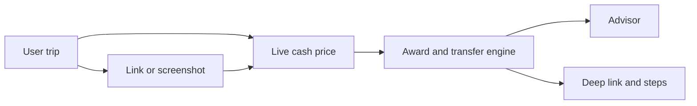

# BookMyflight

Anyone checks a trip, sees how much they can save by travel hacking it, and books the flight. Or they get clear steps to book it.

This repository is the web app. The API, the award chart, and the tests live in the backend repository: [hackathon-1-idea-2-nandani-backend](https://github.com/nandinin822/hackathon-1-idea-2-nandani-backend).

## The problem

Most people pay full price because travel hacking feels complicated.

The savings are real. They come from miles, points, flexible dates, nearby airports, and smarter routes. Finding them takes knowledge of airline alliances, transfer ratios, and hours of searching. A person with points on two cards, or a trip with more than one stop, usually gives up and pays the cash fare.

## The question

Every user is asking one thing:

**How much could I save on this trip?**

The app answers that in seconds, then lets them book.

## What we give the user

| Way in | Who it is for | What they enter | What they get |
| --- | --- | --- | --- |
| Quick flight | They already know the route and the date | From, to, date, cabin, and the points already on their cards | Normal price, hacked price, saving in money and percent, and three booking steps |
| Full trip plan | The trip has several stops, dates, and travellers | Each stop, the dates, the travellers, and the points or the monthly spend that will earn them | A priced plan for the whole trip, then the same booking steps |

What we ask:

- The trip: one route, or several stops with dates and travellers.
- The points they already have. If the trip is months away, what they spend each month and which cards they hold.
- Optional: a booking link or a screenshot, so they do not retype the fare.

What we solve:

- They do not have to know which alliance a program sits in, or that Amex and Chase can meet in one frequent-flyer account.
- They do not have to try nearby airports and nearby dates by hand.
- They do not have to guess whether a welcome bonus is worth opening.
- They leave with a number and a next action: book, or follow the three steps.

Points move from a bank into an airline program. They do not move from one bank to another. The user confirms the seat on the airline site before moving points. Transfers usually cannot be reversed.

## How a check runs



The model never invents a fare, a mileage number, or a transfer ratio. It reads what the user typed or uploaded, calls the price and award engines, and explains that result in English.

## The five systems

**1. Travel hack copilot and advisor.** Gemini 1.5 Flash or GPT-4o-mini. Example: "I spend about 40,000 rupees a month. I want to fly to Bali in eight months. How do I do it?" The advisor returns which card takes each kind of spend, which program the points transfer into, which month the ticket unlocks, and whether a new card shortens the wait.

**2. Screenshot and link extraction.** Gemini multimodal vision, plus a text parser for links. A screenshot or a Google Flights, Skyscanner, or MakeMyTrip link supplies the flight number, date, route, and cash price.

**3. Live cash flight prices.** Amadeus, Duffel, or SerpApi against Google Flights. This is the normal price in the comparison.

**4. Award flights and points.** A fixed award rules engine, plus Seats.aero or Roame for seat space. Charts cover Star Alliance, SkyTeam, and Oneworld. The engine only offers a program the user's cards can reach.

**5. Booking.** One click opens that airline's award search with origin, destination, date, and cabin set. The checklist says to move points only after the seat is visible, then pay the tax, not the cash fare.

## Full trip plan

A full trip is several stops, dates, and travellers. The same five systems run once per leg, then the advisor adds them up.

| Piece of the trip | System | What it decides |
| --- | --- | --- |
| Each stop's cash fare | Amadeus, Duffel, or SerpApi | The normal price for that date and that number of travellers |
| Each stop's award | Award engine, then Seats.aero or Roame | Miles and taxes on a program the wallet can reach, including a Lisbon or Doha stopover when the chart allows it |
| Nearby airports and flexible dates | Award engine, compared with the cash feed | Shown beside the date they asked for. The hero price stays on that date |
| Travellers | Both price feeds | Miles, taxes, and cash scale with the party |
| A trip eight months away | Advisor on top of the rules engine | Spend goes to the card with the best transferable earn. A new card is recommended only when its welcome bonus books the trip sooner |
| Booking | One deep link per leg | Each link opens the airline award page for that stop |

The trip, the quote, and the roadmap are stored in MongoDB. The collections are `users`, `wallets`, `trips`, `quotes`, `plans`, and `savedTrips`. Award charts stay in the rules engine. Live fares are fetched at check time, then the result is saved.

## Screens in this app

| Path | What the user does |
| --- | --- |
| `/` | Asks how much they could save, then chooses a quick flight, a full trip, or the eight-month planner |
| `/hack` | Prices one route. `?trip=full` opens stops, dates, and travellers |
| `/book` | Three steps: move the points, open the award search, confirm and ticket |
| `/plan` | Builds the spend roadmap |
| `/transfers` | Shows which bank points move into which airline program |

On a phone, Home, Flight, Plan, and Points sit in a bar at the bottom.

## Run

The page calls `/api` on this dev server. Vite forwards that to the API at `http://127.0.0.1:8000`. Start the backend first. See the [backend README](https://github.com/nandinin822/hackathon-1-idea-2-nandani-backend).

```bash
npm install
npm run dev
```

Open http://127.0.0.1:5173

This app is React 18, Vite, and React Router. Saved trips in the demo stay in the browser. MongoDB is not connected yet. The model and the live fare feeds are not connected yet. The numbers on screen come from the sample chart in the backend.
