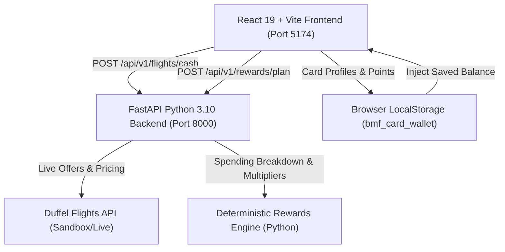

# BookMyFlight / A Una Milla de Tu Destino — Project Demo Guide

## 1. Executive Summary & Problem Solved
**A Una Milla de Tu Destino (BookMyFlight)** is a travel-hacking intelligence and flight search MVP that bridges real airline airfares with credit card loyalty rewards.

### The Problem
- Airline miles and bank rewards points are notoriously confusing for travelers.
- Consumers don't know how many miles a flight typically costs, whether their current credit card spending will get them there, or which bank points transfer to which airlines.
- Most flight engines only show cash prices, ignoring loyalty program optimization completely.

### The Solution
- **Real Cash Flights:** Real-time search powered by Duffel API (with clear labeling for live, sandbox, or demo fixture data).
- **Zero-Credential Card Wallet (`/wallet`):** Secure, client-side wallet where users select their market (US, ES, UK, MX), register cards (e.g., Chase Sapphire Preferred, Amex Gold, Bilt Rewards), and track points balances without sharing banking credentials or card numbers.
- **Deterministic Rewards Planner (`/rewards-planner`):** A backend Python service that calculates exact points earnings across 1, 3, 6, or 12 months based on transparent, verified card earning rules (excluding rent unless using Bilt, applying 3x dining/groceries, 2x travel, etc.).
- **Smart Result Bridging (`/results`):** Connects the user's active wallet balance directly against estimated saver award flight requirements, highlighting any surplus or deficit without misleadingly conflating cash availability with guaranteed award seats.
- **Dedicated Travel Tools:** Interactive 1:1 transfer calculator (`/calculator`), complete multi-stop trip builder (`/trip-planner`), educational alliances guide (`/miles-and-points`), and solutions showcase (`/solutions`).
- **100% Bilingual:** Full English and Spanish localization across every page.

---

## 2. Architecture Overview



---

## 3. Data Provenance & Truth in Data

| Value / Metric | Source | Provenance & Rules |
| :--- | :--- | :--- |
| **Cash Flight Prices & Airlines** | Duffel API | Real live or sandbox API responses. If Duffel token is absent in local dev, explicitly labeled `duffel_demo_fixture` is used. Never faked silently on live call failure. |
| **Points Accumulation Estimates** | Python FastAPI (`app/services/rewards_planner.py`) | Deterministic calculation. Rent earns 0x unless Bilt is selected (1x). Multipliers based on verified issuer terms. |
| **Award Miles Needed (Saver)** | Illustrative Demo Fixture | Clearly marked as estimated saver awards. Cash flight results are explicitly stated **not** to guarantee award seat availability. |
| **Card Catalog Information** | Issuer Terms of Service (`src/data/cardsCatalog.js`) | Verified publicly available earning rules, annual fees, and official issuer transfer links (Chase, Amex, Capital One, Bilt). |

---

## 4. API Endpoints Catalog

### `GET /health`
- **Purpose:** System health check.
- **Response:**
```json
{
  "status": "healthy",
  "version": "1.0.0",
  "duffel_configured": true
}
```

### `POST /api/v1/flights/cash`
- **Purpose:** Search one-way or round-trip cash flights.
- **Query Params:** `demo_mode=false` (or `true` for development demo fixture).
- **Request Payload:**
```json
{
  "slices": [
    {
      "origin": "MAD",
      "destination": "JFK",
      "departure_date": "2026-11-15"
    }
  ],
  "passengers": [
    {
      "type": "adult"
    }
  ],
  "cabin_class": "economy"
}
```
- **Response Highlights:**
  - Returns array of flight offers with `airline_name`, `flight_number`, `price`, `currency`, `live_mode`, `is_demo`, and `demo_notice`.

### `POST /api/v1/rewards/plan`
- **Purpose:** Deterministic calculation of projected rewards points and category breakdown.
- **Request Payload:**
```json
{
  "card_id": "chase-csp-us",
  "current_points": 45000,
  "planning_horizon_months": 6,
  "goal": "cheapest_flight",
  "monthly_rent": 1800,
  "monthly_groceries": 450,
  "monthly_dining": 350,
  "monthly_travel": 200,
  "monthly_utilities": 150,
  "monthly_other": 400,
  "currency": "USD"
}
```
- **Response Highlights:**
  - `monthly_eligible_spend`: Excludes non-earning categories (rent excluded for CSP).
  - `monthly_points_earned`: Applies 3x dining/groceries, 2x travel, 1x other.
  - `total_future_points_earned`: Multiplied across the selected horizon.
  - `projected_total_points`: `current_points + future_points`.
  - `assumptions` and `warnings`: Complete transparency about excluded spend and annual fees.

---

## 5. Local Setup & Startup Commands

### Backend (Terminal 1)
```bash
cd /home/pc/Documents/BMF\ anticode/HP-backend-main
source .venv/bin/activate
uvicorn app.main:app --host 0.0.0.0 --port 8000 --reload
```
- Health check: `curl http://localhost:8000/health`
- Interactive API Docs: `http://localhost:8000/docs`

### Frontend (Terminal 2)
```bash
cd /home/pc/Documents/BMF\ anticode/HP-frontend-main
export PATH="/home/pc/.n/bin:$PATH"
npm run dev -- --host 0.0.0.0 --port 5174
```
- Application URL: `http://localhost:5174/`

### Running Backend Pytest
```bash
/home/pc/Documents/BMF\ anticode/HP-backend-main/.venv/bin/pytest -v
# Output: 20 passed in ~0.8s
```

### Running Frontend Production Build
```bash
export PATH="/home/pc/.n/bin:$PATH"
npm run build
# Output: Built cleanly in ~300ms
```

---

## 6. Live Presentation Demo Script

### English Walkthrough Script
1. **Homepage (`http://localhost:5174/`):**
   > *"Welcome to 'A Una Milla de Tu Destino' / BookMyFlight. Most travelers either overpay in cash or let hundreds of thousands of credit card points expire without knowing how to redeem them. Today, we demonstrate a unified platform that solves this."*
2. **Card Wallet (`/wallet`):**
   > *"First, let's open the Card Wallet. Notice how we do not ask for any banking passwords or card numbers. Users select their market — like the US, Spain, UK, or Mexico — and pick their existing credit cards. For instance, Chase Sapphire Preferred with a starting balance of 65,000 points. The information is persisted securely on the client."*
3. **Rewards Planner (`/rewards-planner`):**
   > *"Next, let's calculate our travel horizon. Say we want to fly to Tokyo in 6 months in Business Class using points. We input our monthly expenses: $1,800 rent, $450 groceries, $350 dining, and $200 travel. When we submit, our Python deterministic engine evaluates verified card rules. Notice that rent is excluded because Chase does not earn points on rent, but groceries and dining earn 3x. In 6 months, we'll earn an additional 23,400 points, projecting our balance to 88,400 points."*
4. **Flight Search & Connected Wallet Results (`/results`):**
   > *"Now let's search for cash flights. Our backend connects directly to Duffel's flight inventory. On the results page, notice the badge: our Card Wallet is automatically connected! We can see our 65,000 Chase Ultimate Rewards balance right alongside the saver award estimates. Clicking 'Select & Continue' opens our transparent Next-Step modal detailing how to complete the booking via the operating airline or transfer partners."*
5. **Additional Utilities:**
   > *"We also provide a dedicated 1:1 Transfer Calculator (`/calculator`), an interactive 4-step multi-city Trip Planner (`/trip-planner`), and an educational Miles & Points alliance guide (`/miles-and-points`) — fully accessible in both English and Spanish."*

### Hinglish Developer Walkthrough Script
1. *"Hamne Phase 1 audit ke baad pure end-to-end architecture ko rock-solid banaya hai."*
2. *"Milestone A me Duffel integration ko sanitize kiya. Agar API key configured hai to real sandbox data aata hai, aur agar key available na ho to transparent `demo_mode=true` fallback diya hai. Kisi bhi fake data ko silently real claim nahi kiya jata."*
3. *"Milestone B me zero-credential `/wallet` implement kiya jisme US, Spain, UK, Mexico ke verified cards hain (Chase, Amex, Bilt). Data `localStorage` me save hota hai bina kisi sensitive banking info ke."*
4. *"Milestone C me deterministic Python service banayi `POST /api/v1/rewards/plan`. Isme rent par 0x points milte hain standard cards me, jabki Bilt me 1x milta hai. 6 months horizon par exact transparent calculation milta hai."*
5. *"Milestone D me `/results` page par saved wallet profile seamlessly show hota hai, jisme available points vs saver award miles calculate hoke clear surplus/deficit dikhta hai."*
6. *"Saare 20 backend unit tests pass ho rahe hain aur frontend production build 100% clean hai."*
